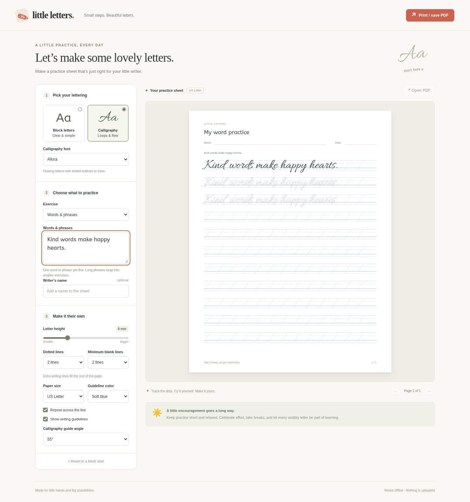
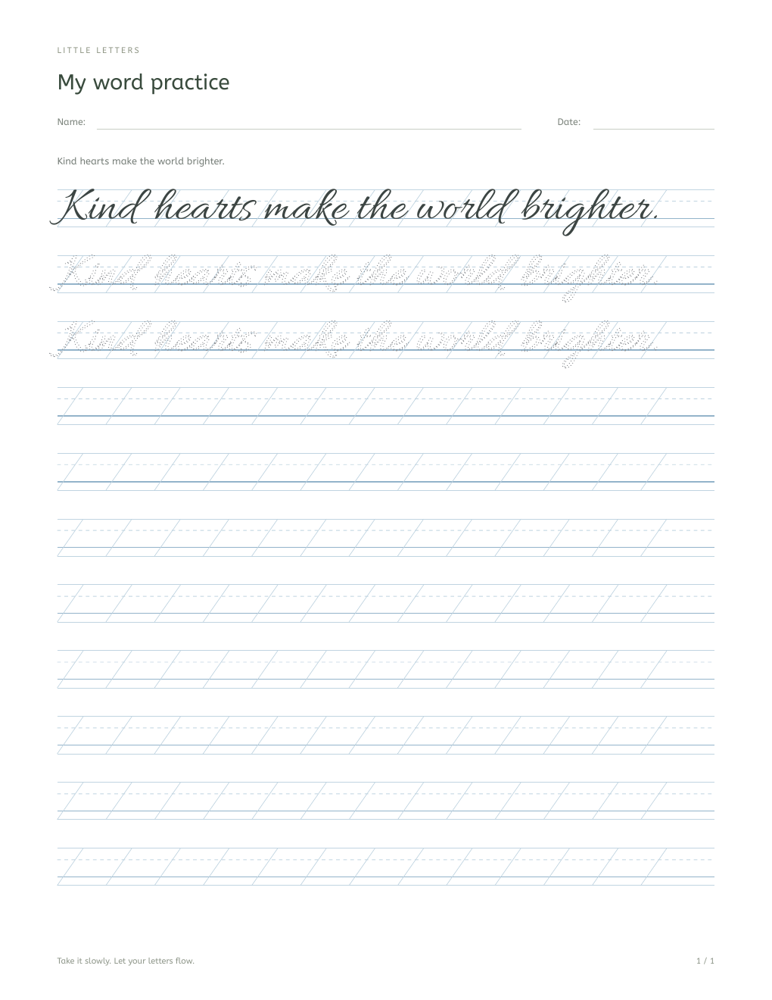
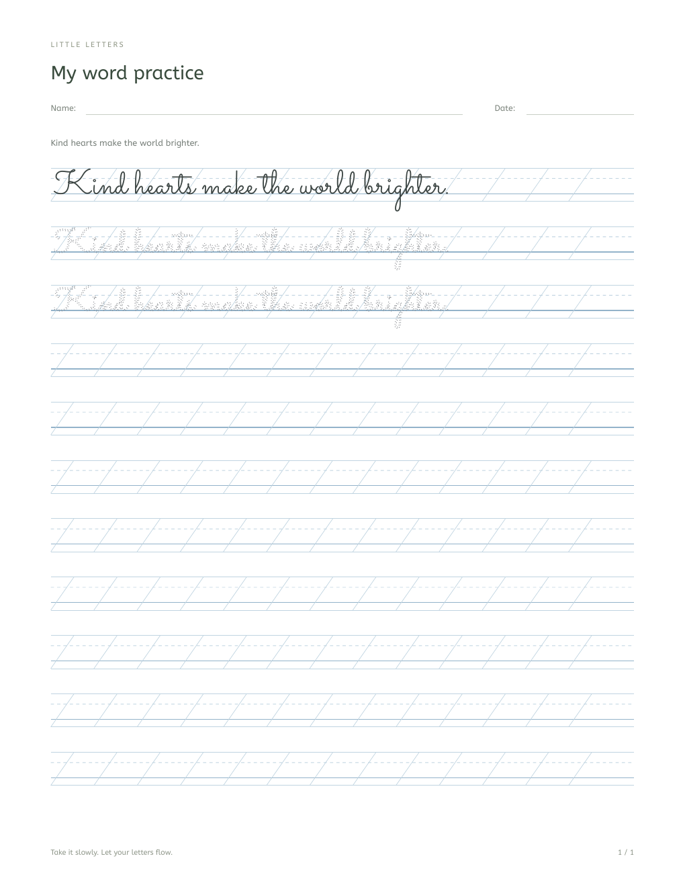
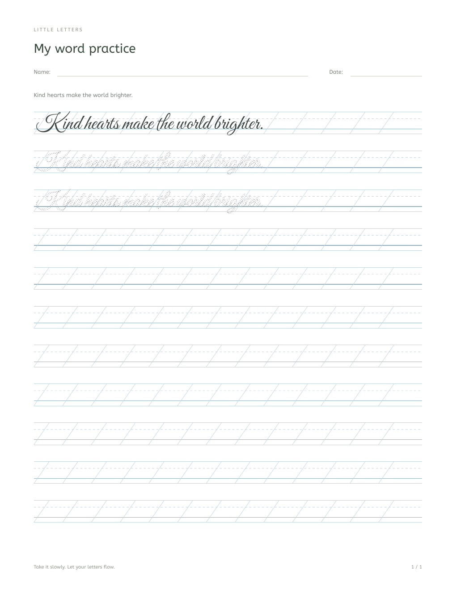

# Little Letters

A local worksheet maker for kids: simple block letters, calligraphy, dotted tracing, and space to practice independently. Also available as an Omarchy bar plugin.

Version **1.1.0** gives every practice row 18 mm more writing space by removing its instruction label. Examples, dotted tracing, and blank practice rows now share the full width between the page margins. PDF export uses Omarchy's existing Cairo/Pango/librsvg libraries and opens the result in the default document viewer.

## Worksheet preview

### The app

Screenshot generated with generic practice text and an empty writer-name field.



### Calligraphy font examples

The same child-friendly sentence, “Kind hearts make the world brighter,” shown in three bundled calligraphy fonts. Each worksheet starts with a solid example, then dotted tracing and full-page writing lines.

<table>
  <tr><th>Allura</th><th>Sacramento</th><th>Great Vibes</th></tr>
  <tr>
    <td></td>
    <td></td>
    <td></td>
  </tr>
</table>

## Omarchy plugin

Install from GitHub with Omarchy:

```sh
omarchy plugin add https://github.com/guirossibrum/LittleLetters.git --enable --yes
```

A pencil icon appears on the right side of the Omarchy bar. **Left-click** opens Little Letters in its own browser app window; **right-click** opens it in a browser tab. All seven fonts, dotted tracing, full-page writing lines, and PDF generation work offline. The launcher starts one on-demand local helper for native PDF export; no packages or system fonts are installed.

Omarchy keeps the plugin in `~/.config/omarchy/plugins/grbrum.littleletters/`. Update it with `omarchy plugin update grbrum.littleletters --yes`. You can also open it directly:

```sh
~/.config/omarchy/plugins/grbrum.littleletters/bin/little-letters
```

Move or remove the bar plugin using Omarchy:

```sh
omarchy bar move grbrum.littleletters --section right --after grbrum.easymath
omarchy plugin remove grbrum.littleletters
```

Git-installed plugins update with `omarchy plugin update grbrum.littleletters --yes`. Browser preferences stay in the browser profile and are associated with the app's file location; the original standalone app remains available when installing the plugin.

### Dependencies and permissions

The bar widget requires Omarchy's Quattro/Quickshell shell and its `qs.Ui` components. The launcher uses Bash, `/usr/bin/python3`, and `omarchy launch webapp`, which uses Omarchy's supported Chromium-based browser. Native export uses system Pycairo, PyGObject, Pango, librsvg, and Fontconfig; `xdg-open` opens the document viewer. These are existing Omarchy desktop libraries and tools. The plugin downloads or installs no packages. Standalone browser printing only needs a modern browser.

`omarchy plugin add` and `omarchy plugin remove` manage the plugin through Omarchy's own Git workflow. Installation requires no root privileges, changes no keyboard or window settings, registers no system service, and installs no fonts. Browser-stored preferences and generated documents remain available after plugin removal.

The native helper listens only on `127.0.0.1`, reuses its existing local port when available, and exits after ten minutes without an open app's heartbeat. PDF requests require a random session secret and matching origin; static serving exposes only app assets. Request logging is disabled. No external service or remote build is used. Bundled fonts are registered only inside the helper process, and retain their SIL Open Font Licenses. There is no bundled JavaScript PDF engine or encoded font-data script.

## Use in a browser

Run **`bin/little-letters --browser`** for the complete app, including native PDF export. You can also open **index.html** directly for previewing worksheets and using the browser's **Print / save PDF** button; **Open PDF** requires the launcher and its local helper. No account or internet connection is required.

- Choose **Block letters** or **Calligraphy**.
- In Calligraphy, choose **Allura, Italianno, Sacramento, Parisienne, Dancing Script, Great Vibes, or Pinyon Script**. All seven are bundled with the app for offline use. Your selection is remembered and used in both the preview and PDF.
- Choose letters, a name, words, numbers, pen warm-ups, or blank writing lines.
- Enter one practice item per line. Alphabet shortcut buttons fill in letter sets.
- Each item starts with a solid example, followed by **two dotted tracing lines and at least two blank practice lines** by default. Extra blank writing lines fill the remaining page space. Change the line counts and letter height to suit your child.
- Choose US Letter or A4, guideline color, and optional calligraphy slant guides.
- Use the arrows to preview all pages. **Print / save PDF** prints the complete worksheet; choose “Save as PDF” in the browser’s print dialog to save it. Print at 100% / actual size and turn off browser headers and footers if enabled.
- **Open PDF** generates the complete worksheet with the native renderer and opens it in your default document viewer. PDF generation works offline and embeds the lettering fonts.

Block letters use original single-line vector paths for A–Z, a–z, 0–9, common accented Latin letters (including Portuguese accents), and common punctuation. Accented letters keep the same letter shape, spacing, and stroke weight as their base letters. The dotted letters follow the same centerline as the example. Lowercase `a` and `g` use simple single-storey forms. Other characters fall back to ABeeZee and use dotted outlines. Calligraphy uses the selected font with dotted **outlines**, so children trace the edges of each letter. Calligraphy samples are font-based references rather than stroke-order instruction. Guide angles change the background guides, not the shapes of the letters.

Long phrases split into smaller exercises. Large lettering or extra lines continue onto new pages. Worksheets are limited to 100 pages, with a visible notice if content exceeds that limit. Empty text produces no worksheet. Preferences and entered text are saved in this browser’s local storage when available. Reset clears the saved values to their defaults. Practice text is never uploaded to an external server or saved in project files. The repository contains generic test text, and personal worksheet exports and records are excluded by `.gitignore`.

Native PDF export sends the worksheet only to the authenticated helper on this computer. PDFs use opaque filenames under `~/.local/share/littleletters/worksheets/` (or `XDG_DATA_HOME`), with owner-only directory and file permissions (`0700`/`0600`). Session credentials stay in an owner-only `littleletters` directory under `XDG_RUNTIME_DIR`, falling back to `~/.cache/littleletters`. PDF filenames and process arguments contain no writer names. Removing the plugin preserves those private documents; delete them separately when no longer needed.

All bundled fonts use the SIL Open Font License. Copyright notices, licenses, and source details are in [assets/fonts](assets/fonts/README.md). The browser and native renderer use the same original TrueType files.

Development checks: `omarchy plugin validate .`, `qmllint BarWidget.qml`, `bash -n bin/little-letters`, `python -B tests/plugin.py`, `/usr/bin/python3 -B tests/native_pdf.py`, `node --check app.js`, and `node --check glyphs.js`. The browser smoke test in `tests/browser.cjs` uses Playwright, system Chromium, and the native system libraries; it starts an isolated helper and blocks external network requests. Its desktop opener is stubbed so tests never open document-viewer windows.
